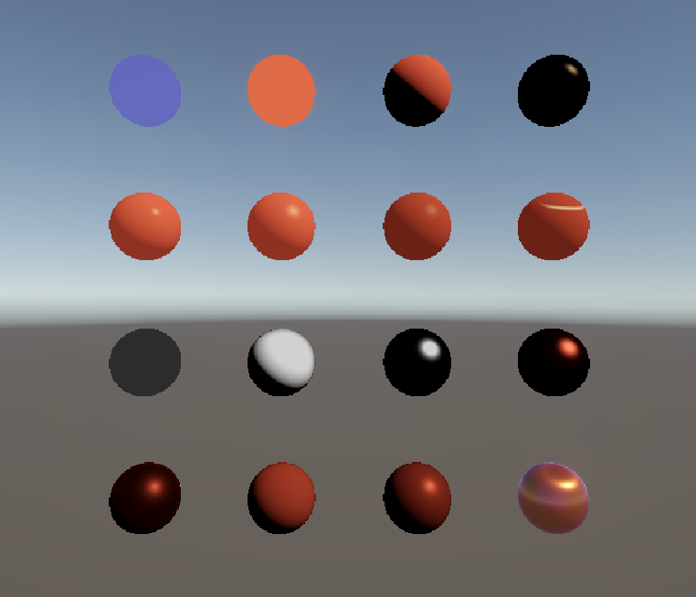

# はじめに
プログラムワークショップⅣの第3回の管理用です

# 結果画像

- 工夫した点：PBRをベースに異方性反射とRGB分散を組み合わせた独自シェーダーを作成した。反射に方向性を持たせ、視線角度や波長ごとの屈折率の違いによって反射色が変化するようにした。

# 進め方

- 本リポジトリをforkしてください。
- fork先のリポジトリを更新してください
- Unityのプロジェクトをsrc内で進めて下さい。
- 結果を画面キャプチャして、画像としてリポジトリに追加して、上記のリンクから見れるようにしてください。
- 完成したら本リポジトリのmainブランチにpull requestを投げてください
